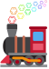

# Reaction Learn

Reaction Learn is a Quizlet-style trainer for named reactions and reagents in organic chemistry. Everything is in one HTML file.

**Play it here:** https://chemtrain.github.io/reaction-learn/reaction_learn.html

You can also download `reaction_learn.html` and open it in any browser.

## What's inside

- 278 cards in 20 sets: 231 reactions (carbonyl C–C bonds, enolates and acyl anions, alkenes and alkynes, alkyne couplings and enediynes, cross-coupling, organometallic reagents, oxidations, epoxides and diols, reductions, rearrangements, cycloadditions, functional groups, acids, esters and amines, arenes, multicomponent reactions, heterocycles, silicon, phosphorus and sulfur chemistry, radical reactions) and 47 reagents (oxidants and reductants; ylides, bases and more). Nearly all the named reactions on the Organic Chemistry Portal's list have a card, and so does every named reaction or reagent mentioned on a card
- Where another reagent would also work under the conditions shown (PCC or DMP), it is never offered as a wrong answer, and naming it counts as right
- Some reactions give a different product under other conditions (the Fries rearrangement hot or cold, HBr with or without peroxides); the condition that decides is highlighted, and both outcomes are asked
- A reaction scheme for every card, with the bonds that break and form highlighted
- A short mechanism for every card, with a link to the Mechanism section of its Wikipedia article
- A Learn mode that asks you to answer with the product (pick it from four), the conditions (pick them from four), the name (of the reaction, or of the reagent hidden in the scheme) or a description (what it does), plus flashcards and a browsable list of cards with a search across all sets
- Draw: draw the product yourself on a sketch pad, which starts with the starting materials (and a reagent that brings atoms, such as mCPBA or NBS) for you to change. The drawing is compared with the product, stereochemistry included where the product has it; for a racemic product either enantiomer counts, and counter-ions may be left out. Products with an R group are picked from four instead
- Click a reagent in the conditions (Eschenmoser's salt, Koser's reagent, DBU, NMO and 68 more) to see its structure: such reagents are shown in colour with a small ring icon, and a stroke of colour runs twice around them when a question appears
- Which is which: 14 families of four related reagents (metathesis catalysts, hypervalent iodine, Cr(VI) oxidants, hydrides, diazo, olefination, fluorinating and triflating reagents, amide bases, oxidants, azodicarboxylates, coupling and radical reagents), drawn side by side; name each one, then see what tells them apart

## Sources

Descriptions, notes and mechanisms are written for this quiz. Each card links to its English Wikipedia article. Structures are drawn with [RDKit](https://www.rdkit.org). The Draw question's sketch pad and structure comparison are [OpenChemLib JS](https://github.com/cheminfo/openchemlib-js) (BSD 3-Clause), loaded from jsDelivr when a Draw question first comes up.

## How to cite

If you use Reaction Learn in a course, a worksheet or a paper, please cite it:

> Bindschaedler, Q. P. *Reaction Learn* (2026). ChemTrain. https://github.com/ChemTrain/reaction-learn

GitHub's **Cite this repository** button (from `CITATION.cff`) gives the same reference in APA and BibTeX.

## License

- Code (the HTML, CSS and JavaScript): [MIT](LICENSE).
- Content (the cards, schemes, descriptions, notes and mechanisms): [CC BY 4.0](LICENSE-CONTENT.md). You may reuse and adapt it, as long as you credit Reaction Learn.
- Logo (`logo.svg`): the locomotive is adapted from [Twemoji](https://github.com/jdecked/twemoji), © Twitter, Inc and other contributors, licensed under [CC BY 4.0](https://creativecommons.org/licenses/by/4.0/); the benzene-ring smoke was added for ChemTrain.
